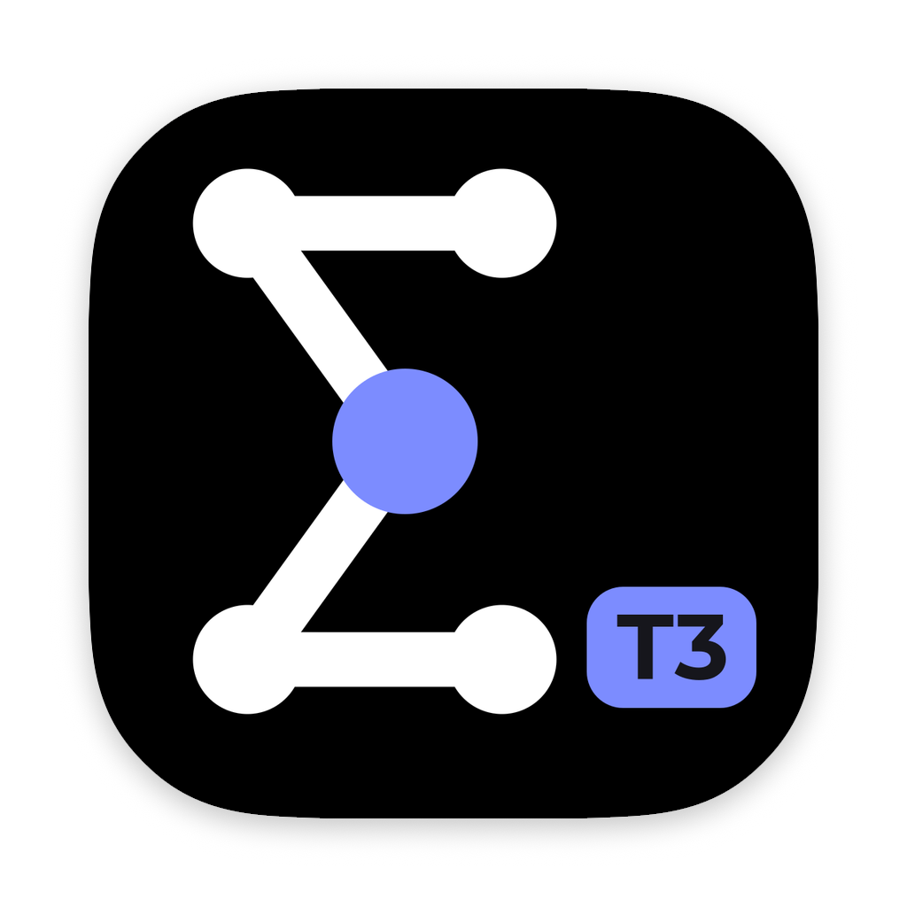
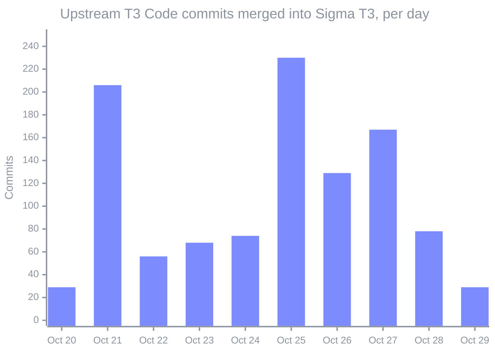
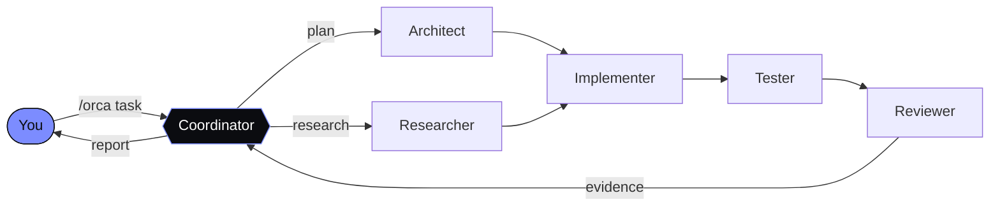
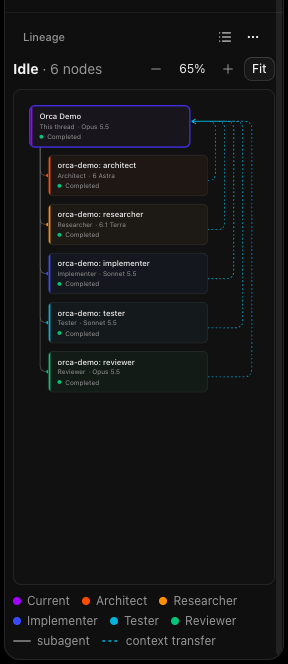
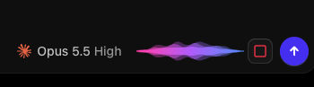
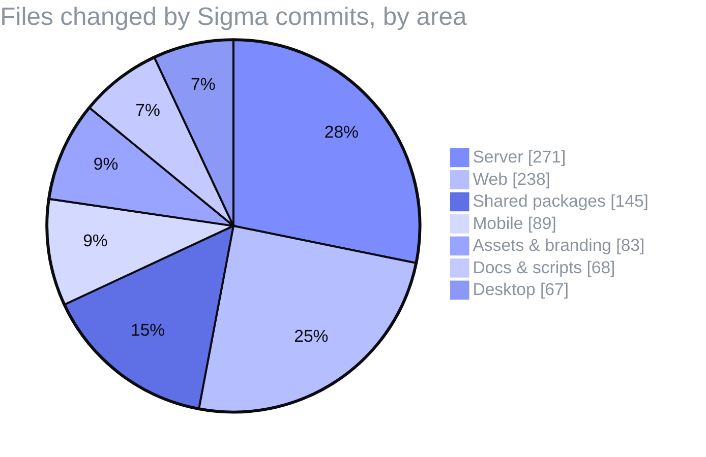
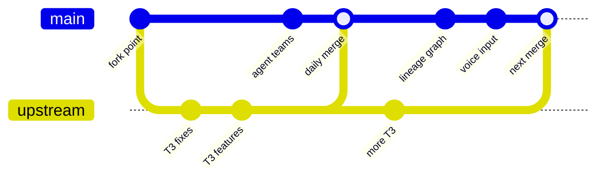

<div align="center">



# Sigma T3

**A control surface for coding agents, built on [T3 Code](https://github.com/pingdotgg/t3code), with agent teams, a lineage graph, multi-folder projects and local voice input on top.**

[](https://github.com/pingdotgg/t3code)
[](./docs/operations/sigma-upstream-sync.md)
[](https://github.com/drenkas/sigma-t3/commits/main)
[](https://github.com/drenkas/sigma-t3/commits/main)
[](./LICENSE)

[What's new](#whats-added-on-top-of-t3-code) ·
[Upstream sync](#kept-in-step-with-t3-code) ·
[Getting started](#getting-started) ·
[Docs](#documentation)

</div>

---

> [!NOTE]
> **Sigma T3 is actively maintained.** Every change from [`pingdotgg/t3code`](https://github.com/pingdotgg/t3code) is merged in daily with ordinary merge commits, so you get upstream T3 Code's providers, fixes and features together with the additions below. Upstream history is preserved in full.

Sigma T3 runs the coding agents already on your machine (Claude Code, Codex, Cursor, Grok Build, OpenCode, Antigravity and more) from one desktop, web or mobile client. It keeps everything that makes T3 Code good: it's fast, works remotely, uses your own subscriptions and is open. On top of that it adds the tools from the original [Sigma](https://github.com/drenkas/Sigma) project for running **several agents on work that spans several repositories**.

## At a glance

<div align="center">

| 🔀 Upstream commits merged | 🔁 Upstream merges | ✨ Sigma commits | ⏱️ Behind upstream |
| :------------------------: | :----------------: | :--------------: | :----------------: |
|         **1,066**          |       **31**       |      **51**      |       **0**        |

<sub>From the fork point (20 Oct 2026) to 29 Oct 2026.</sub>

</div>



## What's added on top of T3 Code

|     | Feature                      | What you get                                                                                                                                                                                                                                                                                                  |
| :-: | ---------------------------- | ------------------------------------------------------------------------------------------------------------------------------------------------------------------------------------------------------------------------------------------------------------------------------------------------------------- |
| 🧑‍🤝‍🧑  | **Agent teams**              | `/roles` gives each role (architect, researcher, implementer, reviewer, tester) its own model. Each project has its own team, with an optional default for projects that have none. `/role` changes one role.                                                                                                 |
| 🎼  | **`/orca` orchestration**    | The agent plans the task, hands each part to the right team role, has a separate reviewer check the result, and reports back with evidence. It does small tasks itself and asks before splitting medium ones.                                                                                                 |
| 🕸️  | **Lineage graph**            | Shows any thread's parents, forks, subagents and handoffs as an interactive graph. Nodes are coloured and named by role and show the model they ran on, including provider-native and remote subagents. Zoom, pan and Fit are built in.                                                                       |
| 📁  | **Multi-folder projects**    | A project can span up to 20 folders. The first is the agent's working folder; Claude, Cursor and ACP agents get the rest as additional directories, and Codex gets them as writable roots. Add folders by picking or dropping them, start a project from several folders, and share folders between projects. |
| 🌿  | **Git in every folder**      | Branch, commit, push/publish and pull for each extra folder, right from the chat details panel. When pull fails it says why, and it rebases diverged local commits, rolling back if they conflict.                                                                                                            |
| 🎙️  | **Local voice input**        | Dictation runs on the server with Parakeet TDT v3 through sherpa-onnx, so it works from the desktop app, a local browser and remote clients alike. A live waveform shows while you speak, and Enter sends once the transcript is in. The model unloads after five idle minutes.                               |
|  Σ  | **Own identity & privacy**   | Sigma T3 is its own app (`com.drenkas.sigma-t3`) with its own data in `~/.sigma-t3` and its own URL schemes. It installs beside official T3 Code without touching its data. Telemetry is off by default, and nothing is imported from other installs unless you ask.                                          |
| 📦  | **One-command local builds** | `pnpm run sigma:preview-install` builds the current `origin/main`, signs it and installs it to `/Applications`. The version names the commit it was built from, and a stable signing identity keeps macOS permissions across rebuilds.                                                                        |

Fork tables migrate separately ([`SigmaMigrations.ts`](./apps/server/src/persistence/SigmaMigrations.ts)), so upstream schema changes always merge cleanly.

### How `/orca` splits a task



Every role runs on the model you chose for it, across providers, and each subagent shows up in the lineage graph under its role.

### In the app

<table>
  <tr>
    <td align="center" valign="top" width="50%">
      
      <br />
      <sub><b>Lineage graph</b> of a real <code>/orca</code> run. Five roles ran on four models from two providers (GPT 6 Astra, GPT 6.1 Terra, Sonnet 5.5, Opus 5.5); dashed lines show context handed back to the coordinator.</sub>
    </td>
    <td align="center" valign="top" width="50%">
      
      <br />
      <sub><b>Voice input</b> in the composer: a live waveform while you dictate. Press Enter to stop, transcribe locally and send.</sub>
    </td>
  </tr>
</table>

### Where Sigma's changes live



## Kept in step with T3 Code

Sigma T3 follows upstream instead of drifting away from it. Upstream changes land in `main` daily:



- **Merge commits only.** No squashing or rebasing, so `git log` shows exactly which upstream commit each sync brought in.
- **Sigma features are kept in conflicts.** Fork fields inside upstream schemas, the Sigma identity and fork migrations stay as they are; upstream's changes go in around them.
- **Checked before pushing.** Every sync installs from the lockfile and runs typecheck and the affected tests. A conflict that needs a real decision becomes a PR for review instead of a direct merge.

The full routine is in [docs/operations/sigma-upstream-sync.md](./docs/operations/sigma-upstream-sync.md).

## Getting started

> [!IMPORTANT]
> Sigma T3 has no public releases yet: you build it locally. The install commands, App Store apps and package registry entries for official T3 Code install **T3 Code, not Sigma T3**.

Install and sign in to at least one provider first:

| Provider    | Install                                                                  | Sign in                 |
| ----------- | ------------------------------------------------------------------------ | ----------------------- |
| Claude Code | [claude.com/product/claude-code](https://claude.com/product/claude-code) | `claude auth login`     |
| Codex       | [Codex CLI](https://developers.openai.com/codex/cli)                     | `codex login`           |
| Cursor      | [Cursor CLI](https://cursor.com/cli)                                     | `agent login`           |
| Grok Build  | [Grok Build CLI](https://x.ai/cli)                                       | `grok login`            |
| OpenCode    | [opencode.ai](https://opencode.ai)                                       | `opencode auth login`   |
| Antigravity | Settings → **Install Antigravity**                                       | **Sign in with Google** |

### Install the macOS app (Apple silicon)

You need the Node version from `engines` in [`package.json`](./package.json) and pnpm 12.

```bash
git clone https://github.com/drenkas/sigma-t3.git
cd sigma-t3
pnpm run sigma:preview-install
```

The script builds `origin/main` in a separate `../sigma-t3-build` worktree, checks the signature and replaces `/Applications/Sigma T3.app`; the previous copy goes to the Trash. Run it again whenever you want the latest build. **Settings → About** shows which commit you're running. For signing and packaging details, see [fork identity and local packaging](./docs/operations/sigma-fork.md).

### Run from source

Sigma T3 uses [Vite+](https://viteplus.dev/guide/), so install `vp` first (`curl -fsSL https://vite.plus | bash`, or `irm https://vite.plus/ps1 | iex` on Windows).

```bash
vp i          # install dependencies
vp run dev    # start the server and web app
```

In a worktree, dev state stays in that worktree's `.t3` folder and doesn't touch your installed app's data.

### Mobile and remote access

The official T3 Code mobile app ([iOS](https://apps.apple.com/us/app/t3-code-remote-claude-more/id6787819824), [Android](https://play.google.com/store/apps/details?id=com.t3tools.t3code)) connects to a Sigma T3 server like it does to any T3 server, over your local network or Tailscale. Open **Settings → Connections** to pair. See [remote access](./docs/user/remote-access.md).

## Documentation

- **Sigma T3:** [fork identity and local packaging](./docs/operations/sigma-fork.md) · [upstream sync](./docs/operations/sigma-upstream-sync.md) · [agent team, `/roles` and `/orca`](./docs/user/composer.md#agent-team) · [projects with several folders](./docs/user/project-settings.md#projects-with-several-folders) · [voice input](./docs/user/composer.md#voice-input-on-web-and-desktop)
- **From T3 Code:** [FAQ](./docs/user/faq.md) · [install and first run](./docs/user/install.md) · [permission modes](./docs/user/permission-modes.md) · [keyboard shortcuts](./docs/user/keybindings.md) · [project settings](./docs/user/project-settings.md) · [appearance](./docs/user/appearance.md) · [outside agents over MCP](./docs/user/outside-agents.md) · [source control](./docs/user/source-control.md) · [background service](./docs/user/background-service.md)
- Multiple accounts: [Codex](./docs/user/providers-codex.md) · [Claude](./docs/user/providers-claude.md)
- **Building from source:** [architecture overview](./docs/internals/overview.md)

## Credits

Sigma T3 stands on [T3 Code](https://github.com/pingdotgg/t3code) by [T3 Tools](https://t3.codes) and its contributors, and every bit of their work reaches this fork through the daily sync. Please don't report problems with Sigma's own features to the T3 Code maintainers.

Released under the [MIT License](./LICENSE).
